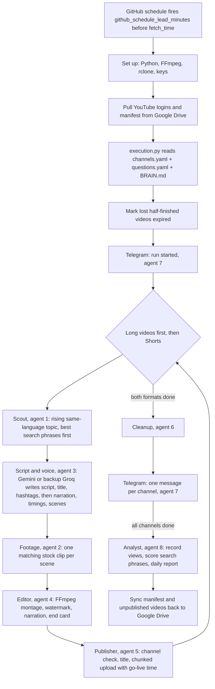

# Execution Guide

Everything you need to run the YouTube automation lives in this folder:

| File | Purpose |
|---|---|
| `execution.py` | **The only file you run.** Works from GitHub, any IDE, a terminal, or Copilot. |
| `execution.md` | This guide: setup, rules and how to run. |
| `questions.yaml` | **The answers.** What and when each channel posts: genre, language, voice, how many videos, how often. Options are written beside each question. |
| `channels.yaml` | **The channel page.** Who each channel is: name, made for kids, watermark, category. |

`BRAIN.md` (one folder up) holds the global rules every channel shares: editing style, storage folders and AI writing instructions. You rarely need to touch it.

---

## Golden Rules

1. **Create each YouTube channel yourself**, then list it in `channels.yaml` and answer its questions in `questions.yaml` under the **same key**.
2. **`execution.py` always reads `questions.yaml`.** To change what a channel does, change the answers there, not the code.
3. **Copy options exactly** from the comments: quotes, spaces and capital letters matter (`"1 hour"`, `"Telugu"`, `"-5%"`).
4. **After any change to either file, run** `python execution/execution.py --check`, **then push to GitHub.** The check validates both files, shows each channel's posting plan and daily YouTube usage, and updates the GitHub schedule.
5. **Every channel needs a YouTube login** (`token_<key>.json`) before it can upload. See *Adding a Channel*, step 4. Sign in with **the Google account that owns the channel**. This can be a different account from the one that owns the Google Cloud project; if the OAuth consent screen is still in Testing mode, add that account under **Test users**.
6. **Test first:** set `test_run: true` for a new channel. It makes the videos without uploading them.
7. **Stay within YouTube's daily limits:** 100 uploads and 100 searches per day, shared by all channels. `--check` shows your total.
8. **Never commit secrets.** `.env`, `client_secret.json` and `token_*.json` are git-ignored.

---

## What Happens When the Job Runs



### The GitHub job ([daily_youtube_agents.yml](../../.github/workflows/daily_youtube_agents.yml))

| Step | What it does |
|---|---|
| 1. Checkout | Gets the latest code from `main` |
| 2. Python 3.11 | Sets up Python |
| 3. Decide which channels are due | Scheduled run: the channel(s) whose `fetch_time` matches. Manual run: the channel you typed. Nothing due means the job stops here at almost no cost. |
| 4. Install FFmpeg & rclone | Video tools and the Google Drive connection |
| 5. Install dependencies | Everything in `requirements.txt` |
| 6. Restore API keys | Writes the GitHub secrets into `.env` and `client_secret.json` |
| 7. Pull from Google Drive | YouTube logins (`00_tokens`), the manifest (`01_manifests`) and any finished-but-unpublished videos |
| 8. Run the pipeline | `python execution/execution.py --scheduled --cron "<time>"` (or your manual options). See below. |
| 9. Sync back to Google Drive | Saves the updated manifest, logins and any unpublished videos for the next run. Runs even if step 8 failed. |

### The pipeline (step 8), for each due channel

1. **Clear lost work:** unfinished videos whose files are gone are marked `expired`, because GitHub starts every run on a fresh machine.
2. **Long videos, then Shorts.** Long videos go first so they are uploaded hours before their go-live times. For each format:

| Agent | Does | Uses |
|---|---|---|
| **1. Scout** ([agent_1_scout.py](../agents/agent_1_scout.py)) | Finds trending YouTube videos on your `search_phrases` (Shorts for Shorts, 4 to 20 minute videos for long ones), in your `language`. It ranks them by **views per hour** (what is rising right now), skips sources in another language (other scripts, Hinglish, or a title naming another language), tries the search phrases whose videos got the most views first, and avoids recent or excluded source channels. Only the topic is used, never the video itself. | YouTube Data API |
| **3. Script & Voice** ([agent_3_voiceover.py](../agents/agent_3_voiceover.py)) | Gemini writes an original script, and in the same request the upload title, description, hashtags and 5 footage terms for the whole topic (one request instead of three). Hook first; long videos get 3 to 5 parts, a recap and a comment question. Narrated with your `voice` and `voice_speed`, **sentence by sentence with its own pitch, speed and volume** (`voice_expression`: the hook lifts, questions rise, exclamations pop, plain sentences vary, the ending slows), recording when each sentence is spoken. If the narration is longer than allowed, it's shortened and narrated again. Then it's split into scenes: about 6 per Short, one about every 8 seconds in long videos. | Gemini (or Groq), edge-tts |
| **2. Footage** ([agent_2_downloader.py](../agents/agent_2_downloader.py)) | Each scene gets a specific search term (news channels name the person, country, ship or event) plus a generic backup. With `footage_style: "real"` (Frontline) the specific term is first looked up as **real footage of the actual people and events** on Wikimedia Commons; otherwise one clip per scene comes from Pixabay (cartoon or real-life per `footage_style`), and only clips whose tags match the scene's **subject** are used (style words like "cartoon", "funny" or "cute" don't count, so a random cartoon can't stand in for a turtle). On kids channels, when no video shows the subject, a matching Pixabay **cartoon illustration** is used instead, with a slow zoom, before falling back to the generic backup term. The log prints a **sync report**: each scene's time range, the footage shown and the words spoken. | Wikimedia Commons, Pixabay |
| **4. Editor** ([agent_4_editor.py](../agents/agent_4_editor.py)) | On WonderSprout, adds the superhero host (intro, corner host with expressions, outro; see below). FFmpeg cuts every clip to its scene's narration time and fits it to 1080×1920 (Short) or 1920×1080 (long); in Shorts, real footage is shown whole on a blurred copy of itself so the people in it aren't cropped out. It joins them, overlays the watermark, adds only the narration, and appends the LIKE → SUBSCRIBE end card. | FFmpeg |
| **5. Publisher** ([agent_5_publisher.py](../agents/agent_5_publisher.py)) | Confirms the YouTube login is the channel in `channels.yaml`. Uses the title, description and hashtags written with the script, plus the stock-footage credit. If they're missing it asks Gemini, and if Gemini is unavailable (quota used up) it uses the source video's title so the finished video still goes out. Uploads in 8 MB resumable chunks, scheduled to go live at its slot. | YouTube Data API |

3. **6. Cleanup** ([agent_6_cleanup.py](../agents/agent_6_cleanup.py)): on GitHub, deletes clips, narration and published videos. On a laptop, deletes `YouTube_Auto` day folders older than `keep_days`.
4. **7. Telegram** ([agent_7_notifier.py](../agents/agent_7_notifier.py)): when a run starts, one message says it's preparing videos (and how late GitHub started it). After each channel finishes, one message per channel lists every uploaded video with its title, link and go-live time, and says if any were not uploaded.
5. **8. Analyst** ([agent_8_analyst.py](../agents/agent_8_analyst.py)): reads the views, likes and comments of every video uploaded in the last 14 days and saves them in the manifest. A video's views after 48 hours score the search phrase that found its topic; the Scout uses the best phrases first and re-tries any phrase unused for 3 days. Once a day it posts a Telegram report: videos and views per channel over 7 days, the best video, and the best and weakest topic.
6. **RESULT:** the log ends with how many videos each channel uploaded. If a channel uploaded nothing, the job is marked failed; if it uploaded some but not all, the run stays green with a yellow warning.

**Gemini usage:** 1 request per Short (script, title, hashtags and each scene's footage terms together) and 2 per long video (script, then per-scene footage terms for its ~20 scenes): about 20 a day for both channels. The free tier allows 20 requests a day **per model**, reset at 12:30 IST, so the 4 models in `ai_models` share the load. Requests are spaced 4 seconds apart. If every model is rate-limited, the run waits one minute and tries again; if they're still limited, the daily quota is used up, so the rest of the run skips Gemini (footage falls back to the topic terms, titles to the source video's title).

**Backup AI:** when every Gemini model is out of quota or busy, the same request goes straight to **Groq** (free, no card, about 1,000 requests a day per model; `openai/gpt-oss-120b`, then `qwen/qwen3.8-27b`), so videos are still made. The log shows `[AI] Gemini unavailable; written by groq ...`, and the start of every run logs whether the Groq key is set. Change or add backups under `ai_fallbacks` in `BRAIN.md`. Gemini still writes Hindi and Telugu best, so it stays first.

### A typical day

Both channels run together three times a day: 13 videos in all. Each run sends a Telegram "run started" message, then one message per channel when its videos are uploaded, and once a day the Analyst's performance report.

| Run (IST) | Frontline Ledger (8 a day) | WonderSprout (5 a day: long videos do better there) |
|---|---|---|
| 06:00 morning | long 12:00, Shorts 08:00 and 10:00 | long 11:30, Short 09:00 |
| 13:00 afternoon | long 16:30, Shorts 14:00 and 16:00 | long 16:00, Short 14:30 |
| 17:00 evening | Shorts 18:00 and 19:00 | long 18:30 |

YouTube publishes each video at its time even though the GitHub job finished hours earlier.

**Start times:** GitHub starts scheduled runs late (4 to 5 hours in October 2026), so `github_schedule_lead_minutes` in `BRAIN.md` (265) makes the GitHub schedule fire that much earlier: 01:35, 08:35 and 12:35 IST, so runs start near 06:00, 13:00 and 17:00. If GitHub is ever on time, the run simply starts early; the videos still go live at their times. The start message shows how early or late each run was; if it drifts, change the lead and run `--check`. A go-live time that has already passed by upload time goes live 10 minutes after upload instead, 30 minutes apart.

**Hashtags:** each video gets up to 12 hashtags in its description. YouTube shows the first three above the title, so they are the two hashtags the **fastest-rising videos in the niche are using right now** (counted by the Scout across ~15 trending videos, weighted by views per hour) and the strongest topic hashtag. Then `#shorts` for Shorts, the other topic hashtags from the AI (2 broad, 3 specific to the story), the remaining trending ones, and the source video's own. Generic tags (#viral, #fyp, #trending) and other channels' names are left out. The same words, plus the footage topic terms, go into the video's search tags. The Telegram message lists them.

---

## How Posting Works

For each channel, every day it is scheduled (`days`):

1. **At `fetch_time`**, GitHub starts the pipeline:
   - It finds trending topics for your `genre` and `search_phrases` on YouTube.
   - It downloads matching **free stock clips from Pixabay** (or Pexels). YouTube blocks downloading its videos from cloud servers like GitHub's, and stock footage also avoids copyright claims.
   - It writes a script in your `language`, narrates it with your `voice` at your `voice_speed`, and edits the clips into a montage.
2. **It uploads all `videos_per_day` videos at once**, each with its own go-live time: the first at `first_post_time`, then one every `post_frequency`.
3. **YouTube publishes each video exactly at its time**, even though GitHub has already finished.

Example: `fetch_time "06:00"`, `first_post_time "07:00"`, `post_frequency "1 hour"`, `videos_per_day 12` → videos go live at 07:00, 08:00, 09:00 … 18:00.

**Several runs a day:** give `fetch_time` a list, e.g. `["06:00", "13:00"]`. `videos_per_day` and `long_videos_per_day` stay day totals; each run makes the videos whose go-live time falls between its fetch time and the next one. `--check` prints each run's share, e.g. `Run 06:00 -> 1 long (12:00) + 2 Shorts (08:00, 11:00)`. A one-off run with `--videos`, `--first-post`, `--frequency` or `--post-now` ignores the split and uses the numbers you typed.

| `post_frequency` | 12 videos starting 07:00 go live |
|---|---|
| `"15 mins"` | 07:00, 07:15 … 09:45 |
| `"30 mins"` | 07:00, 07:30 … 12:30 |
| `"1 hour"` | 07:00, 08:00 … 18:00 |
| `"3 hours"` | 07:00, 10:00 … 16:00 the next day (too long, so `--check` warns you) |

**Long videos (Q22 to Q24)** are made in the same run, **before** the Shorts, so they're ready well ahead of their go-live times. Their length never exceeds the upper number of `long_video_minutes`: if the narration runs long, the script is shortened and narrated again.

| | Shorts | Long videos |
|---|---|---|
| Shape | Vertical 1080×1920 | Landscape 1920×1080 |
| Length | `video_length_seconds` (15 to 60 s) | `long_video_minutes` (Frontline 5 to 7 min, WonderSprout 4 to 6 min plus her intro and outro) |
| Topics from | Trending Shorts | Trending 4 to 20 minute videos on the same search phrases |
| Script | Hook plus one idea | Hook, 3 to 5 parts, recap and a question for comments |
| Footage | About 6 scenes (`clips_per_video`), one matching clip each | One matching clip about every 8 seconds (`long_scene_seconds`), about 30 to 50 |
| Goes live | `first_post_time`, then every `post_frequency` | At each `long_post_times` entry |

A long video takes roughly 12 minutes to build on GitHub (videos are assembled with FFmpeg for speed). `--check` estimates the monthly GitHub time for all your answers.

**Every video looks and sounds the same way:**
- **Audio:** only the AI narration; the source video's own sound is removed.
- **Watermark:** in the bottom-right corner.
- **End card:** a 3-second closing card with the channel name in large text, a **LIKE** button first, then **SUBSCRIBE**.
  - Change the card's length or wording, or turn it off, under `end_card` in `BRAIN.md`.
  - To also show a logo, set `show_logo: true` there. The logo is the channel's YouTube profile picture, saved in `GDrive_Mount/YouTube_Automation/00_branding/`, or the image set as `logo_file` in `channels.yaml`.

If preparing the videos takes longer than planned, a passed go-live time is replaced by one shortly after upload. Allow at least 30 minutes between `fetch_time` and `first_post_time` (about 3 minutes per Short, 12 per long video).

---

## The Questions (`questions.yaml`)

| # | Question | Field | Options |
|---|---|---|---|
| Q1 | Channel to post to | the key (e.g. `kids_edu`) | Any key from `channels.yaml` |
| Q2 | Include this channel? | `run` | `true` \| `false` |
| Q3 | Genre to source trending videos for | `genre` | Any text |
| Q4 | YouTube searches that find trending Shorts | `search_phrases` | 1 to 5 lines; add `#shorts` to each |
| Q5 | Narration language | `language` | `"English"` \| `"Hindi"` \| `"Telugu"` |
| Q6 | Narrator voice | `voice` | See voices below; must match the language |
| Q7 | Speaking speed | `voice_speed` | `"-15%"` slow and very clear \| `"-5%"` clear (recommended) \| `"+0%"` natural \| `"+10%"` brisk |
| Q7b | How lively the voice is | `voice_expression` | `"lively"` (kids: big highs and lows) \| `"measured"` (news: subtle emphasis) \| `"off"` (one even tone, the old way). Default: lively for made-for-kids channels, measured for others |
| Q8 | Narration style | `tone` | Any text |
| Q9 | Length of each video | `video_length_seconds` | `15` \| `30` \| `45` \| `60` |
| Q10 | Words the script must never use | `avoid_words` | `[]` or `["word1", "word2"]` |
| Q11 | Use trending videos from the last N days | `lookback_days` | `1` to `30` |
| Q12 | When to fetch and prepare videos | `fetch_time` | `"HH:MM"` (24-hour), or a list like `["06:00", "13:00"]` for several runs a day |
| Q13 | When each Short goes live | `short_post_times` | A list like `["08:00", "10:00"]`, one per Short. Or leave it out and use Q13 to Q15 below |
| Q13 | When the first Short goes live | `first_post_time` | `"HH:MM"` |
| Q14 | Gap between Shorts | `post_frequency` | `"15 mins"` \| `"30 mins"` \| `"1 hour"` \| `"3 hours"` |
| Q15 | Shorts to post each day (all runs together) | `videos_per_day` | `1` to `50` |
| Q16 | Which days | `days` | `"daily"` \| `"weekdays"` \| `"weekends"` \| `[mon, wed, fri]` |
| Q17 | Timezone for all times | `timezone` | `"Asia/Kolkata"`, `"America/New_York"`, `"Europe/London"`, … |
| Q18 | Who can see the videos | `visibility` | `"public"` \| `"unlisted"` \| `"private"` |
| Q19 | Make videos without uploading | `test_run` | `true` \| `false` |
| Q20 | YouTube channels never to take videos from | `exclude_sources` | `[]` or `["Channel Name 1", "Channel Name 2"]` |
| Q22 | Long landscape videos per day | `long_videos_per_day` | `0` (none) to `4` |
| Q23 | Length of each long video | `long_video_minutes` | `4` \| `5` \| `6` \| `7` \| `"4-5"` \| `"4-6"` \| `"5-6"` \| `"5-7"` \| `"6-7"` (a range gives each video a different length, never above the upper number) |
| Q24 | When each long video goes live | `long_post_times` | one `"HH:MM"` per long video, e.g. `["14:00", "20:00"]` |
| Q21 | Kind of clips used | `footage_style` | `"any"` \| `"animation"` (cartoon) \| `"film"` (real-life stock) \| `"mixed"` (cartoon and real-life alternate) \| `"real"` (real footage of the actual people and events from Wikimedia Commons first, then real-life stock). Pexels has no cartoon filter. |

**How source videos are picked:** the Scout searches the channel's phrases **best first** (the Analyst orders them by how many views their videos got after 48 hours; phrases not used for 3 days are tried again first), and only as many phrases as it needs (about one YouTube search per video). Within a search it ranks videos by **views per hour** (what is rising now) and skips videos in another language. It takes **at most one video per source channel per run**, avoids channels used for any of that channel's last 5 videos, and never uses channels in `exclude_sources`. Only the topic is used, never the video itself.

Delete a line to use its default. Defaults: English, a natural voice for the language, `-5%` speed (`-15%` for kids), 30-second videos, last 5 days, 1 video, `"1 hour"`, daily, `Asia/Kolkata`, public, uploads on. If `first_post_time` is left out, videos go live as soon as they are uploaded.

**Voices:**

| Language | Voice | Style |
|---|---|---|
| English | `en-US-AvaMultilingualNeural` | Female, expressive, very natural (**WonderSprout**) |
| English | `en-US-BrianMultilingualNeural` | Male, casual, very natural (**Frontline**) |
| English | `en-US-EmmaMultilingualNeural` / `en-US-AndrewMultilingualNeural` | Female cheerful / male warm, very natural |
| English | `en-US-AndrewNeural` | Male, warm, all-rounder |
| English | `en-US-ChristopherNeural` | Male, authoritative, news |
| English | `en-US-GuyNeural` | Male, energetic, sports |
| English | `en-US-AriaNeural` | Female, confident, news |
| English | `en-US-EmmaNeural` | Female, cheerful, kids and education |
| English | `en-US-AnaNeural` | **Child voice** (young girl); best for kids channels |
| English | `en-US-JennyNeural` | Female, friendly, calm |
| English | `en-IN-PrabhatNeural` / `en-IN-NeerjaNeural` | Indian English, male / female |
| Hindi | `hi-IN-MadhurNeural` / `hi-IN-SwaraNeural` | Male / female |
| Telugu | `te-IN-MohanNeural` / `te-IN-ShrutiNeural` | Male / female |

For Hindi and Telugu, scripts, titles and descriptions are written in the native script. Write `search_phrases` in whichever language finds the best trending videos for your genre.

---

## The Channel Page (`channels.yaml`)

| Field | Required | Options |
|---|---|---|
| *key* | yes | Lowercase letters, numbers, underscores; starts with a letter; unique |
| `channel_name` | yes | Exactly as on YouTube |
| `channel_url` | yes | The channel link: `https://www.youtube.com/@handle` or `https://www.youtube.com/channel/UC...`. Sign-in and every upload check that the YouTube login is this exact channel, so videos never go to the wrong one. |
| `made_for_kids` | yes | `true` \| `false` (`true` only for children under 13: legal COPPA setting, limits ads) |
| `watermark_text` | no | Default `@` + channel name |
| `logo_file` | no | Image for the end card, e.g. `"execution/logos/my_logo.png"`. Default: the channel's YouTube profile picture |
| `category_id` | no | `"24"` Entertainment (default), `"25"` News & Politics, `"27"` Education (default for kids), `"17"` Sports, `"28"` Science & Technology. The full list is in the file. |

---

## One-Time Setup

| # | Step | How |
|---|---|---|
| 1 | Python environment | `python -m venv C:\Users\<you>\venvs\yt`, then `C:\Users\<you>\venvs\yt\Scripts\python.exe -m pip install -r requirements.txt`. A short path avoids Windows' long-path error, and no admin rights are needed. |
| 2 | API keys | Copy `.env.example` to `.env` and fill in `YOUTUBE_API_KEY`, `GEMINI_API_KEY`, and optionally the Telegram values. |
| 3 | Upload permission | Save your Google Cloud **OAuth Desktop client** file as `client_secret.json` in `youtube-automation-agents`. On the OAuth consent screen click **Publish app**; otherwise logins expire every 7 days. |
| 4 | Google Drive | Create the folder `YouTube_Automation/00_tokens/`. |
| 5 | rclone | `rclone config` and create a remote named exactly **`gdrive`** (type: drive). |
| 6 | Stock footage key | Create a free account at [pixabay.com](https://pixabay.com/accounts/register/), open [pixabay.com/api/docs](https://pixabay.com/api/docs/) while logged in, copy the key shown under **Parameters → key**, and add it to `.env` as `PIXABAY_API_KEY`. (A Pexels key in `PEXELS_API_KEY` also works.) |
| 7 | GitHub secrets | Repo → Settings → Secrets and variables → Actions. Add the 8 secrets below. |

| Secret | Contents |
|---|---|
| `YOUTUBE_API_KEY` | YouTube Data API v3 key |
| `GEMINI_API_KEY` | Gemini API key |
| `PIXABAY_API_KEY` | Pixabay API key (free stock footage). To use Pexels instead, add a `PEXELS_API_KEY` secret and pass it in step 6 of the workflow the same way. |
| `TELEGRAM_BOT_TOKEN` | Telegram bot token |
| `TELEGRAM_CHANNEL_ID` | Telegram channel ID (starts with `-100`) |
| `GROQ_API_KEY` | Free backup AI (console.groq.com → API Keys). Optional but recommended |
| `CLIENT_SECRET_JSON` | Full contents of `client_secret.json` |
| `RCLONE_CONFIG_GDRIVE` | Full contents of the file shown by `rclone config file` |

---

## Adding a Channel

1. **Create the channel on YouTube:** [youtube.com/channel_switcher](https://www.youtube.com/channel_switcher) → **Create a channel**.
2. **`channels.yaml`:** copy the TEMPLATE, paste it under `channels:`, remove the `# `, and fill in the 5 lines.
3. **`questions.yaml`:** copy the TEMPLATE, paste it under `channels:` with the **same key**, remove the `# `, and answer each question by copying an option from its comment.
4. **Sign in to YouTube:** `python execution/execution.py --authorize <key>`. Upload the token file it prints to Google Drive `YouTube_Automation/00_tokens/`.
5. **Check:** `python execution/execution.py --check`
6. **Test:** `python execution/execution.py --channel <key> --dry-run`
7. **Push to GitHub** so the schedule goes live: `git add -A`, `git commit -m "Add <key>"`, `git push`.

To pause a channel, set `run: false`. To remove one, delete it from both files. Then run `--check` and push.

---

## Ways to Run

### GitHub (automatic)

Nothing to do. Each channel runs at its `fetch_time` on its `days`.

### GitHub (manual)

GitHub → **Actions** → **Daily YouTube Multi-Agent Pipeline** → **Run workflow**. Leave any field blank to use `questions.yaml`.

| Field | Meaning |
|---|---|
| `channel` | `all` (every channel with `run: true`) or one channel key |
| `genre` | One-off genre |
| `videos` | One-off number of videos |
| `first_post_time` | One-off first go-live time (`HH:MM`) |
| `frequency` | One-off gap: 15 mins, 30 mins, 1 hour or 3 hours |
| `format` | `both` (default), `short` (Shorts only) or `long` (long videos only) |
| `dry_run` | Tick to make videos without uploading |

### IDE, terminal or Copilot

Open `execution.py` and press **Run**, or run this from the `youtube-automation-agents` folder:

```bash
C:\Users\<you>\venvs\yt\Scripts\python.exe execution/execution.py
```

It runs **every channel with `run: true`** using its answers in `questions.yaml`. To have Copilot (or any assistant) run it, say:

> Run `python execution/execution.py` from the `youtube-automation-agents` folder using `C:\Users\<you>\venvs\yt\Scripts\python.exe`.

### Interactive one-off (`--ask`)

`python execution/execution.py --ask` asks the questions on screen, starting from your `questions.yaml` answers, and runs once. `questions.yaml` itself is not changed.

---

## Command Reference

| Command | What it does |
|---|---|
| `python execution/execution.py` | Run every channel with `run: true`, using `questions.yaml` |
| `... --channel KEY` | Run one channel |
| `... --channel all` | Same as no arguments |
| `... --genre "cricket highlights"` | One-off genre (search becomes `"<genre> #shorts"`) |
| `... --videos 6` | One-off number of videos |
| `... --first-post "09:00"` | One-off first go-live time |
| `... --frequency "30 mins"` | One-off gap: `"15 mins"`, `"30 mins"`, `"1 hour"` or `"3 hours"` |
| `... --post-now` | One-off: every video goes live as soon as it is uploaded |
| `... --visibility unlisted` | One-off visibility: `public`, `unlisted` or `private` |
| `... --dry-run` | Make videos, don't upload |
| `... --format short` / `--format long` | Make only Shorts, or only long videos (default: both) |
| `python execution/execution.py --ask` | Answer the questions on screen for a one-off run |
| `python execution/execution.py --check` | Validate both files, show plans and YouTube usage, update the GitHub schedule |
| `python execution/execution.py --list` | Show channels, plans and YouTube login status |
| `python execution/execution.py --authorize KEY` | Sign in to YouTube for a channel |
| `python execution/execution.py --hero-art FOLDER` | Import pictures of the WonderSprout character into `assets/wondersprout/` (see [PROMPTS.md](../assets/wondersprout/PROMPTS.md)) |
| `python execution/execution.py --learn LINK` | Analyse a YouTube video about getting views and add its techniques to [view_techniques.md](view_techniques.md) as a proposal to review (laptop only) |

---

## Getting More Views

[view_techniques.md](view_techniques.md) holds what we've learned about views:
- **ACTIVE RULES** are sent to Gemini with every script, title and hashtag (trends first, stay in the niche, write for retention, honest click-worthy titles).
- **HOW THE PIPELINE APPLIES THEM** lists what the code does (rising topics, same-language sources, the Analyst's feedback loop, the fixed schedule) and what the owner does by hand (thumbnails after phone verification, checking view duration and click-through rate in Studio).
- **SOURCES** records every video analysed and what was adopted or rejected.

To learn from a new video, run `python execution/execution.py --learn <link>` on the laptop (or give the link to Claude). It adds a "proposed" entry; nothing changes until good rules are copied into ACTIVE RULES. Anything that fakes engagement, misleads viewers or re-uploads other people's content is rejected: it breaks YouTube's policies.

## WonderSprout, the Kids Channel's Superhero Host

WonderSprout is the kids channel's superhero host and narrator (`mascot: "wondersprout"` in `channels.yaml`, made-for-kids channels only). The AI writes each script as her, in the first person, in the channel's voice (Ava).

| Part | What viewers see and hear | Setting (`editing_rules.mascot` in `BRAIN.md`) |
|---|---|---|
| Intro (long videos) | She swoops in through a sky of drifting clouds with a whoosh, hovers, waves and says `intro_line` ("Hey kids! This is Wonder Sprout, your fun and learning superhero!"); her name pops up with a sparkle chime, over a soft wind sound (about 6 s) | `intro_long`, `intro_line` |
| Host | In the bottom-left corner throughout: amazed ("Whoa!"), thinking ("Can you guess…?"), asking (questions), happy, waving, talking, sentence by sentence; her mouth moves with the voice | `host` |
| Shorts opening | She swoops into her corner during the first second while the hook plays (a separate intro makes Shorts viewers swipe away; `intro_shorts: true` adds it anyway) | `intro_shorts` |
| Outro | In the sky she waves and says `outro_line` ("Wonder Sprout signing off, kids! We'll meet next time!"), then flies off into the distance with a whoosh and a sparkle trail, before the LIKE / SUBSCRIBE card (about 6 s) | `outro`, `outro_line` |

The intro and outro add about 12 seconds; long kids videos can therefore run a little past `long_video_minutes` (agreed by the owner: up to 7 to 8 minutes is fine).

**Your own intro and outro videos.** If `assets/wondersprout/intro.mp4` / `outro.mp4` exist (optional vertical `intro_short.mp4` / `outro_short.mp4` for Shorts), every video uses them instead of the generated ones, fitted to the video's shape without stretching (a clip without sound gets silence). What to provide: [assets/wondersprout/PROMPTS.md](../assets/wondersprout/PROMPTS.md); drop files in Google Drive `YouTube_Auto/wondersprout_assets/`.

**Status:** the owner's character (9 poses) and intro/outro videos were imported on 2026-10-24 and are in `assets/wondersprout/` (kept in git, so GitHub runs use them; `setup_project.py` holds only text files, so copy that folder too when moving the project).

**Her look.** Until pictures of the real character are added, the pipeline draws a simple cartoon version ([mascot.py](../agents/mascot.py)). The real character (from the owner's reference image) needs 9 pictures of her in different poses, because one picture can't change expression or talk:
1. Make them with the free Gemini app or ChatGPT from the reference image, using the prompts in [assets/wondersprout/PROMPTS.md](../assets/wondersprout/PROMPTS.md) (plain magenta background).
2. Run `python execution/execution.py --hero-art "<folder with the pictures>"`. It cuts out the background (or keeps a transparent one), keeps only her (an image AI's corner logo such as "Grok" is dropped), cleans any magenta fringe from her hair, crops and resizes the pictures into `assets/wondersprout/`, imports `intro.mp4` / `outro.mp4` with a small green "WS" badge covering the image AI's logo in the bottom-right corner, and saves a preview sheet.
3. Commit and push, so GitHub's runs use them. From then on she replaces the drawing everywhere; a missing pose borrows the closest one.

(The Gemini API's free tier can't generate images, so this step is done by hand once; with billing on, it could be automated for under $1.)

## Where the Footage Comes From

Set under `footage` in `BRAIN.md`:

| `source` | What it does | Works on GitHub? |
|---|---|---|
| `"stock"` (default) | The script is written and narrated first, and the narration is split into scenes using the voice's sentence timings (about `clips_per_video` scenes in a Short, one about every `long_scene_seconds` in a long video). Gemini picks a search term from **each scene's own words**, one matching clip per scene is downloaded from Pixabay or Pexels (`provider`), and each clip plays exactly while its scene is narrated. Descriptions credit the site and the contributors, as both sites ask. | Yes |
| `"youtube"` | Re-uses the trending video itself. | **No.** YouTube blocks downloads from cloud servers ("Sign in to confirm you're not a bot"). Works only when run from your laptop. |

`clips_per_video` (6) sets how many clips a Short uses and `long_scene_seconds` (8) how often a long video changes clip; faster changes hold attention better. The free limits (Pixabay: 100 requests a minute; Pexels: 200 an hour) are enough; searches are paced.

**Real footage (`footage_style: "real"`, Frontline):** for each scene that names a person, country, ship or event, the pipeline searches **Wikimedia Commons** for real video of it (official government channels such as the White House, US military, Kremlin.ru, the Ukrainian president's office and the EU publish there, often within days). Rules:
- **Licences:** only public domain, CC0 and CC BY are used; share-alike, non-commercial and no-derivatives licences are skipped because they don't allow use in a monetised video.
- **Match:** every name word of the scene's term must be in the clip's title (a Zelensky scene gets Zelensky footage); longer terms are retried with just the name ("Narendra Modi summit" → "Narendra Modi").
- **Only the needed seconds** are fetched, from about a quarter into the video (skipping intros), so long speeches aren't downloaded whole. A matching video already used is reused from a later moment rather than adding more credits.
- **Credit:** each clip's author, licence and link are listed in the description.
- **No video of it? A real photo:** when Commons has no matching video, a freely licensed real photo of the person, place or event is used instead: shown whole on a blurred copy of itself (faces are never cropped) with a slow zoom.
- Scenes with no real video or photo use real-life Pixabay clips.

News-agency footage (Reuters, AP, ANI, broadcasters' YouTube channels) is **not** used: it's copyrighted, would bring Content ID claims and copyright strikes, and can get a channel removed.

## Where Video Files Are Kept

| Run from | Downloaded videos | Narration and final (uploaded) videos | Deleted |
|---|---|---|---|
| Your laptop / IDE / Copilot | `H:\My Drive\YouTube_Auto\<YYYY-MM-DD>\download\` (Google Drive) | `H:\My Drive\YouTube_Auto\<YYYY-MM-DD>\upload\` | Whole day folders older than 2 days, automatically at the end of each run |
| GitHub | Temporary folders on GitHub's machine | Temporary folders on GitHub's machine | Right after upload; the machine is wiped after every run |

Change the folder or the number of days under `local_media` in `BRAIN.md` (`root`, `keep_days`). If Google Drive for Desktop isn't running (no `H:` drive), that run uses `C:\Users\<you>\YouTube_Auto` instead. Files in the Google Drive folder count toward your Drive storage, so the 2-day limit also keeps Drive from filling up. To clear space by hand, delete any day folder you no longer need; videos from that day that weren't uploaded yet are skipped automatically.

The manifest, YouTube logins and logos always stay in `GDrive_Mount/YouTube_Automation/`, because GitHub runs share them through Google Drive.

## Good to Know

- **GitHub may start a scheduled run hours after its scheduled time** (4 to 5 hours in October 2026). `github_schedule_lead_minutes` in `BRAIN.md` compensates (see "A typical day"). Future go-live times are always exact, because YouTube publishes them.
- **Public repository:** Actions minutes are unlimited and secrets stay hidden (GitHub never shows them, masks them in logs, and doesn't give them to pull requests from forks). Run logs are public, so they must never print key values; the code masks them.
- **The workflow file stores times in UTC**, so 06:00 IST appears as `30 0 * * *`. `--check` handles this.
- **Daylight saving:** India has none. For timezones that do, run `--check` and push after each clock change.
- **GitHub free minutes:** private repos get 2,000 a month. A Short takes about 3 minutes to build and a long video about 12. Run `--check` to see the estimate for your answers. If it's near or over 2,000, lower the counts or make the repository public; public repos have unlimited free minutes, and your keys stay safe in GitHub secrets either way.
- **Test-run videos are kept** at "edited" and are uploaded by that channel's next real run.

## Troubleshooting

| Problem | Fix |
|---|---|
| "Please fix these problems" | Each line names the file, channel and field. Copy the correct option from the comment beside it. |
| "No YouTube login file" | `--authorize <key>`, then upload the token to Drive `YouTube_Automation/00_tokens/`. |
| "You signed in to '...' but '<key>' is ..." | You picked a different channel in the browser. Run `--authorize <key>` again and choose the channel matching `channel_url`. |
| "Access blocked" / "app has not completed verification" when signing in | The account that owns the channel isn't a test user. Google Cloud Console → OAuth consent screen → add it under **Test users**, or click **Publish app**. |
| "login is missing or expired" on GitHub | Same as above. If it happens weekly, publish the OAuth consent screen (One-Time Setup, step 3). |
| "Cannot start: No .env file" | Copy `.env.example` to `.env` and fill in the keys. |
| `--check` warns about YouTube usage | Lower `videos_per_day` or the number of `search_phrases`, or request more quota in Google Cloud Console. |
| `pip` says "filename too long" | Use a short-path venv (One-Time Setup, step 1). |
| "429 RESOURCE_EXHAUSTED" from Gemini | The Gemini quota is used up (free tier: 20 requests a day per model, reset at 12:30 IST). Groq takes over automatically if `GROQ_API_KEY` is set (check the run log line "Backup AI when Gemini is out of quota: groq (key set)"). If both are out, finished videos still upload with the source video's title. |
| "The user has exceeded the number of videos they may upload" | YouTube's daily upload limit for that channel (low for new, unverified channels). Verify the channel by phone at youtube.com/verify. The video stays queued and uploads on a later run. |
| Runs start far from 06:00 / 13:00 / 17:00 | GitHub's delay changed. The Telegram start message shows how early or late; change `github_schedule_lead_minutes` in `BRAIN.md`, run `--check` and push. |
| Narration fails | The free voice service occasionally changes. Run `pip install -U edge-tts`. Videos stay queued and retry on the next run. |
